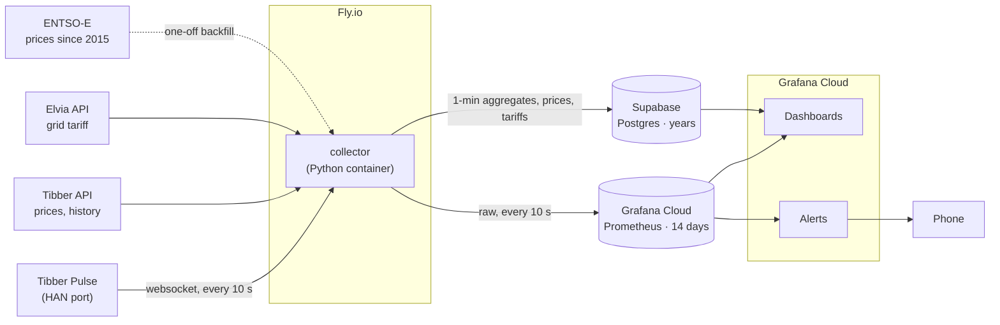

# power-monitor

Home electricity monitoring for a Norwegian household: live data from a Tibber Pulse on the
meter's HAN port, spot prices, grid tariffs, dashboards and alerts in Grafana Cloud, and
multi-year history in Postgres. Nothing runs at home.

- **Fresh data and alerts:** Grafana Cloud's Prometheus, free tier, 14 days.
- **Trends and history:** Supabase Postgres, free tier.
- **Cost:** about 20 NOK a month, all of it Fly.io.

| Docs | |
|---|---|
| [Architecture](docs/architecture.md) | Data flow, what goes where, metrics and tables |
| [Services](docs/services.md) | Every external service: plan, limits, cost |
| [Access](docs/access.md) | Accounts, tokens, scopes and where each one is kept |
| [Configuration](docs/configuration.md) | Environment variables; personal values are never committed |
| [Decisions](docs/decisions.md) | Choices made and why |

## Public repo

This repo is public. Personal details are configuration, not code: the metering point, the
Tibber home id and the main fuse are kept in Fly secrets and a local `.env`. The location isn't
needed and isn't stored.
Consumption data only lives in Grafana Cloud and Supabase, behind a login. See
[configuration](docs/configuration.md).
